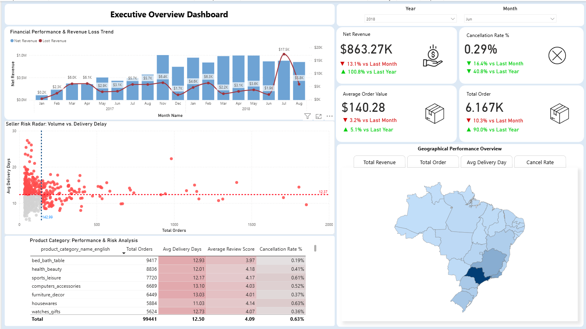
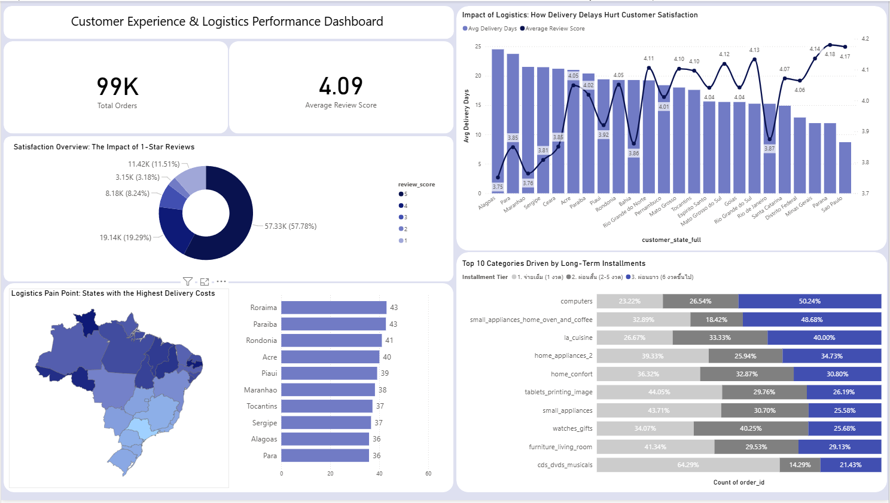

# 🇧🇷 Brazilian E-Commerce (Olist) End-to-End Analytics Pipeline


An enterprise-grade, end-to-end Data Analytics project analyzing **100,000+ real-world commercial orders** from **Olist**, Brazil's largest department store marketplace.

This repository demonstrates the complete analytical lifecycle: **Automated Data Cleansing (Pandas)**, **Relational Star Schema Modeling & Ingestion (PostgreSQL)**, **Advanced KPI & Window Function Engineering (SQL)**, **Exploratory Data Analysis (Matplotlib/Seaborn)**, and **Interactive Business Intelligence Dashboard Design (Power BI)**.

---

## 🏗️ System Architecture & Data Flow

```text
                 [ 8 Raw Olist Datasets (CSV) ]
                              │
                              ▼
        ┌──────────────────────────────────────────────┐
        │       01_data_cleaning.ipynb                 │
        │       ETL & Data Wrangling                   │
        │                                              │
        │  • Type Casting (Datetime, Numeric)          │
        │  • Foreign Key Integrity & Missing Values   │
        │  • Star Schema Normalization                 │
        └──────────────────────┬───────────────────────┘
                               │
                 ┌─────────────┴─────────────┐
                 ▼                           ▼
       [ Processed CSV Entities ]   [ PostgreSQL: olist_db ]
                 │                           │
          ┌──────┴──────┐            ┌───────┴────────┐
          │             │            │                │
          ▼             ▼            ▼                ▼
   4 Dimension      4 Fact      Star Schema      KPI Queries
      Tables        Tables      Constraints      & Indexes
          │             │            │                │
          ▼             ▼            └───────┬────────┘
┌──────────────────────────────┐             │
│ 02_eda_and_advanced_analytics│             │
│                              │             │
│ • Pareto 80/20 Analysis      │             │
│ • RFM Customer Segmentation  │             │
│ • Logistics Latency vs. CSAT │             │
└───────────────┬──────────────┘             │
                │                            │
                └─────────────┬──────────────┘
                              ▼
             [ Power BI Interactive Dashboard ]
                              │
             ┌────────────────┴────────────────┐
             │                                 │
             ▼                                 ▼
    Executive Overview            Customer Experience
                                   & Logistics Performance

    • DAX KPI Measures
    • Time Intelligence (MoM, YoY)
    • Cross-Filtering & Geolocation Maps
```

---

## 📁 Project Structure

```text
brazilian_ecommerce_project/
│
├── dashboard/
│   ├── olist_dashboard.pbix
│   └── screenshots/
│       ├── dash-1.png
│       └── dash-2.png
│
├── datasets/
│   ├── raw/
│   └── processed/
│
├── docs/
│   ├── business_objective.md
│   ├── data_cleaning_plan.md
│   ├── data_dictionary.xlsx
│   ├── kpi_mapping.md
│   ├── erd.dbml
│   └── erd.pdf
│
├── notebooks/
│   ├── 01_data_cleaning.ipynb
│   └── 02_eda_and_advanced_analytics.ipynb
│
├── sql/
│   └── kpi_queries.sql
│
├── .gitignore
└── README.md
```

---

## 🗄️ Database Schema — Star Schema ERD

The database uses a star-schema-oriented structure with dimension tables and fact tables to support business analytics.

```text
                         ┌──────────────────┐
                         │  dim_customers   │
                         └────────┬─────────┘
                                  │ (1:N)
                                  ▼
┌───────────────────┐     ┌──────────────────┐     ┌────────────────────┐
│fact_order_payments│◄────┤   fact_orders    ├────►│ fact_order_reviews │
└───────────────────┘     └────────┬─────────┘     └────────────────────┘
                                   │
                                   │ (1:N)
                                   ▼
                          ┌──────────────────┐
                          │ fact_order_items │
                          └────────▲─────────┘
                                   │
                                   │ (N:1)
                    ┌──────────────┴──────────────┐
                    │                             │
           ┌────────┴────────┐           ┌────────┴────────┐
           │  dim_products  │           │  dim_sellers   │
           └────────────────┘           └────────────────┘
```

The diagram represents the relationships provided for the project. Refer to `docs/erd.dbml` and `docs/erd.pdf` for the schema documentation.

---

## 📊 Interactive Dashboard Previews (Power BI)

### Page 1: Executive Overview Dashboard



> Executive-level snapshot tracking Net Revenue, Cancellation Rates, Average Order Values, Total Orders, Seller Risk Radar (Volume vs. Delivery Delay), and Geographic Performance across Brazil.

### Page 2: Customer Experience & Logistics Performance Dashboard



> In-depth analysis tracking Customer Satisfaction (Review Scores distribution), Logistics Pain Points by State and Delivery Costs, State-wise Delivery Days vs. Review Scores, and Top Categories driven by Installment Tiers.

---

## 📌 Executive Summary & Core Insights

- **Financial Performance & Growth Tracking:** Monitored Net Revenue trends with MoM and YoY comparisons, identifying peak sales periods and cancellation rate fluctuations, with cancellation averages around **0.29%**.
- **Seller Risk Radar:** Evaluated merchant operational risks by plotting total order volumes against average delivery days to identify bottleneck sellers associated with logistics delays.
- **Logistics Latency vs. Customer Satisfaction:** Analyzed regional delivery performance across Brazilian states, highlighting relationships between delivery timeframes and customer review scores, and identifying logistics cost outliers.
- **Payment Behavior & Installment Analysis:** Evaluated transaction structures across installment tiers, including one-installment and short-/long-term payment plans, grouped by top product categories.
- **Geographic Concentration:** Identified **São Paulo (`SP`)** as the dominant commercial hub with the highest concentration of orders and revenue.

---

## 💻 Key Technical Implementations

### 1. Advanced SQL Analytics — `sql/kpi_queries.sql`

- **Window Functions:** Implemented `LAG()` to calculate Month-over-Month (MoM) revenue growth.
- **Cumulative Totals:** Calculated running revenue shares using `SUM() OVER(ORDER BY ...)` for Pareto categorization.
- **Complex Aggregations:** Measured Repeat Customer Rates and Customer Lifetime Value (CLV) using Common Table Expressions (CTEs).
- **Business KPIs:** Organized SQL queries around 10 core business KPIs.
- **Analytical Techniques:** Applied CTEs, window functions, and cumulative aggregations.

### 2. Python EDA & Advanced Analytics — `notebooks/`

- **Data Wrangling:** Automated timestamp parsing, handled missing dimensional attributes, and removed invalid status transactions.
- **RFM Customer Segmentation:** Scored customers across **Recency, Frequency, and Monetary** metrics to classify distinct customer behavior tiers.
- **Pareto Analysis:** Applied the 80/20 rule to analyze contribution and concentration.
- **Logistics Analysis:** Examined the relationship between delivery delays and customer satisfaction.
- **Data Visualization:** Built Line, Bar, and Donut charts with customized data labels using Matplotlib and Seaborn.

### 3. Data Cleaning & Transformation — `01_data_cleaning.ipynb`

- Converted data types, including datetime and numeric fields.
- Validated foreign key integrity.
- Handled missing values.
- Prepared processed CSV entities for downstream analytics.
- Organized the data into dimension and fact tables.

### 4. Power BI Dashboard

- Designed a multi-page interactive report.
- Developed dynamic DAX KPI measures.
- Applied time intelligence for MoM and YoY analysis.
- Implemented cross-filtering and geolocation maps.
- Presented executive-level metrics and customer experience analytics.

---

## 🛠️ Technology Stack

| Category | Technologies |
|---|---|
| Programming Language | Python 3.10+ |
| Data Manipulation | Pandas 2.0 |
| Data Visualization | Matplotlib, Seaborn |
| Database | PostgreSQL 15 |
| Query Language | SQL |
| Business Intelligence | Power BI Desktop |
| Analytics Techniques | RFM, Pareto Analysis, Window Functions, CTEs |
| Data Modeling | Star Schema |

---

## 📂 Documentation

| File | Description |
|---|---|
| `docs/business_objective.md` | Core analytical business questions |
| `docs/data_cleaning_plan.md` | Data cleansing rules and schema design |
| `docs/data_dictionary.xlsx` | Data metadata and dictionary |
| `docs/kpi_mapping.md` | Mapping between business questions and KPI metrics |
| `docs/erd.dbml` | DBML relational schema code |
| `docs/erd.pdf` | Visual Star Schema ERD diagram |
| `sql/kpi_queries.sql` | SQL queries for business KPIs and advanced analytics |

---

## 🎯 Project Objectives

- Analyze Brazilian e-commerce order data.
- Build a data cleaning and transformation pipeline using Python and Pandas.
- Implement a relational star schema in PostgreSQL.
- Develop advanced SQL queries for business KPIs.
- Perform exploratory data analysis and customer segmentation.
- Analyze sales performance, customer satisfaction, and logistics.
- Develop an interactive Power BI dashboard for business intelligence.

---

## 📄 Disclaimer

This project is intended for data analytics, educational, and portfolio demonstration purposes.