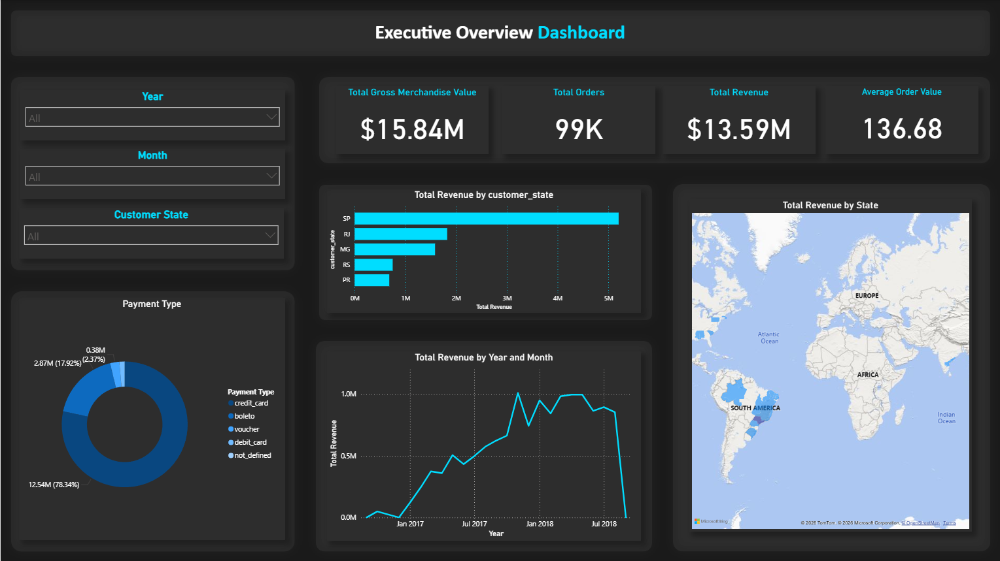
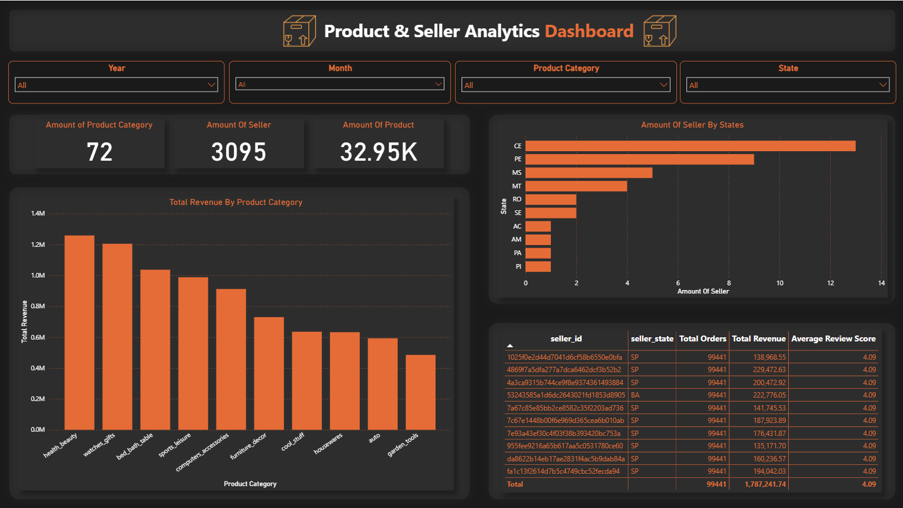
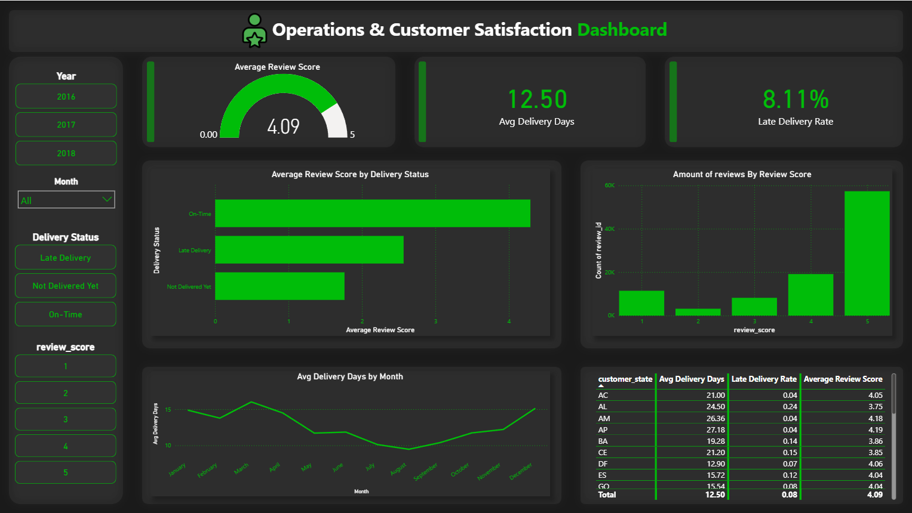

# Brazilian E-Commerce (Olist) End-to-End Analytics Pipeline


An enterprise-grade, end-to-end Data Analytics project analyzing **100,000+ real-world commercial orders** from **Olist**, Brazil's largest department store marketplace. 

This repository demonstrates the complete analytical lifecycle: **Automated Data Cleansing (Pandas)**, **Relational Star Schema Modeling & Ingestion (PostgreSQL)**, **Advanced KPI & Window Function Engineering (SQL)**, **Exploratory Data Analysis (Matplotlib/Seaborn)**, and **Interactive Business Intelligence Dashboard Design (Power BI)**.

---

## System Architecture & Data Flow

```text
                     [ 8 Raw Olist Datasets (CSV) ]
                                   │
                                   ▼
          ┌──────────────────────────────────────────────────┐
          │  01_data_cleaning.ipynb (ETL & Wrangling)        │
          │  • Type Casting (Datetime, Numeric)              │
          │  • Foreign Key Integrity & Missing Value Impute  │
          │  • Star Schema Normalization                     │
          └────────────────────────┬─────────────────────────┘
                                   │
                ┌──────────────────┴──────────────────┐
                ▼                                     ▼
   [ Processed CSV Entities ]            [ PostgreSQL Database (`olist_db`) ]
   • 4 Dimension Tables                  • Star Schema Constraints
   • 4 Fact Tables                       • Primary & Foreign Key Indexes
                │                                     │
                ▼                                     ▼
   ┌───────────────────────────────┐     ┌──────────────────────────────────┐
   │ 02_eda_and_advanced_analytics │     │ kpi_queries.sql                  │
   │ • Pareto 80/20 Rule Analysis  │     │ • 10 Core Business KPIs          │
   │ • RFM Customer Segmentation   │     │ • Window Functions (LAG, OVER)   │
   │ • Logistics Latency vs. CSAT  │     │ • CTEs & Cumulative Aggregations │
   └───────────────┬───────────────┘     └─────────────────┬────────────────┘
                   │                                       │
                   └───────────────────┬───────────────────┘
                                       ▼
                       [ Power BI Interactive Dashboard ]
                       • Multi-Page Storytelling Report
                       • Dynamic DAX KPI Measures
                       • Cross-Filtering & Geolocation Maps  
```
---
## Repository Structure
```text
brazilian_ecommerce_project/
├── dashboard/
│   ├── olist_dashboard.pbix              # Interactive Power BI report file
│   └── screenshots/                      # High-resolution dashboard previews
│       ├── dashboard_1.png               # Page 1: Executive Sales Overview
│       ├── dashboard_2.png               # Page 2: Product & Seller Performance
│       └── dashboard_3.png               # Page 3: Logistics & Customer Satisfaction
├── datasets/
│   ├── raw/                              # Original raw data from Kaggle/Olist
│   └── processed/                        # Cleaned & transformed Star Schema tables
├── docs/
│   ├── business_objective.md             # 10 Core analytical business questions
│   ├── data_cleaning_plan.md             # Data cleansing rules & schema design
│   ├── data_dictionary.xlsx              # Comprehensive metadata & dictionary
│   ├── kpi_mapping.md                    # Business questions to KPI metric mapping
│   ├── erd.dbml                          # DBML relational schema code
│   └── erd.pdf                           # Visual Star Schema ERD diagram
├── notebooks/
│   ├── 01_data_cleaning.ipynb           # Data preprocessing, validation & pipeline
│   └── 02_eda_and_advanced_analytics.ipynb # Advanced EDA, RFM, Pareto & visualizations
├── sql/
│   └── kpi_queries.sql                  # Production SQL queries (CTEs, Window functions)
├── .gitignore                            # Environment & system cache exclusions
└── README.md
```
---
## Relational Data Modeling (Star Schema)
```text
                          ┌──────────────────┐
                          │  dim_customers   │
                          └────────┬─────────┘
                                   │ (1:N)
                                   ▼
┌───────────────────┐     ┌──────────────────┐     ┌────────────────────┐
│fact_order_payments│◄────┤   fact_orders    ├────►│ fact_order_reviews │
└───────────────────┘(N:1)└────────┬─────────┘(1:1)└────────────────────┘
                                   │ (1:N)
                                   ▼
                          ┌──────────────────┐
                          │ fact_order_items │
                          └────────▲─────────┘
                                   │ (N:1)
                   ┌───────────────┴───────────────┐
                   │                               │
           ┌───────┴────────┐              ┌───────┴────────┐
           │  dim_products  │              │  dim_sellers   │
           └────────────────┘              └────────────────┘
```
---

## Interactive Dashboard Previews (Power BI)

### Page 1: Executive Sales Overview
> *Executive-level snapshot tracking platform GMV, Net Revenue, Monthly Trends, Payment Distributions, and State-wise Revenue concentration.*



---

### Page 2: Product & Seller Analytics
> *Product category ranking, 80/20 Pareto revenue distribution, SKU catalog performance, and top-tier merchant benchmarking.*



---

### Page 3: Logistics & Customer Satisfaction (CSAT)
> *In-depth correlation between shipping latency, estimated delivery buffer vs. actual delivery, and customer review scores.*



---

## Executive Summary & Core Insights

* **Revenue Concentration (Pareto Principle):** The top **17 product categories** (~23% of total categories) generate **over 80% of total platform revenue**, dominated by *Health & Beauty*, *Watches & Gifts*, and *Bed, Bath & Table*.
* **Logistics Latency vs. Customer Satisfaction:** Orders delivered **On-Time / Early** yield an average review score of **4.29 / 5.0**, whereas **Late Deliveries** cause satisfaction to collapse to **2.57 / 5.0** (a **-40% drop**), proving transit delay is the primary root cause of customer churn.
* **Payment Behavior:** **73.9%** of gross transactions are completed via **Credit Card** (leveraging installment plans), followed by **Boleto (19.0%)** and **Vouchers (5.6%)**.
* **Geographic Centralization:** **São Paulo (`SP`)** serves as the primary commerce engine, generating over **40% of orders and revenue**.

---

## Key Technical Implementations

### 1. Advanced SQL Analytics (`sql/kpi_queries.sql`)
* **Window Functions:** Implemented `LAG()` to calculate Month-over-Month (MoM) revenue growth velocity.
* **Cumulative Totals:** Calculated running revenue shares with `SUM() OVER(ORDER BY ...)` for Pareto categorization.
* **Complex Aggregations:** Measured Repeat Customer Rates and Customer Lifetime Value (CLV) using Common Table Expressions (CTEs).

### 2. Python EDA & Advanced Analytics (`notebooks/`)
* **Data Wrangling:** Automated timestamp parsing, handled missing dimensional attributes, and removed invalid status transactions.
* **RFM Customer Segmentation:** Scored customers across **Recency, Frequency, and Monetary** metrics to partition user bases into Champions, Loyal Customers, and At-Risk segments.
* **Publication-Quality Plots:** Built styled Line, Bar, and Donut charts with customized data labels and directional callout lines using Matplotlib & Seaborn.
